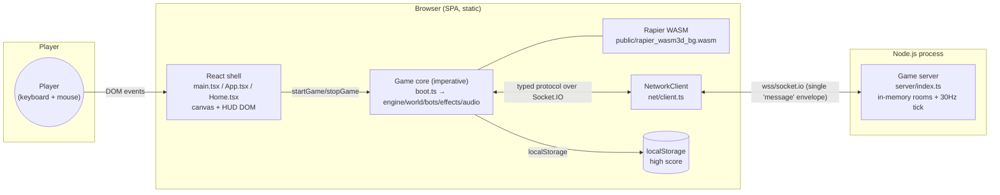
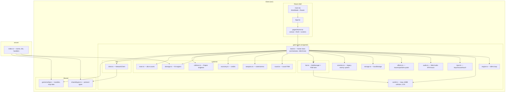
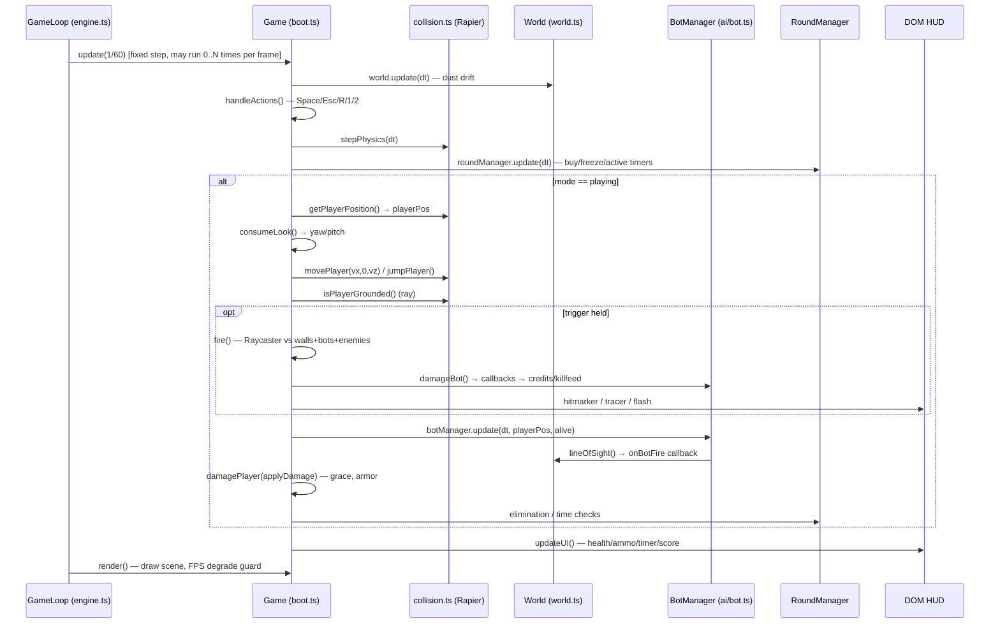
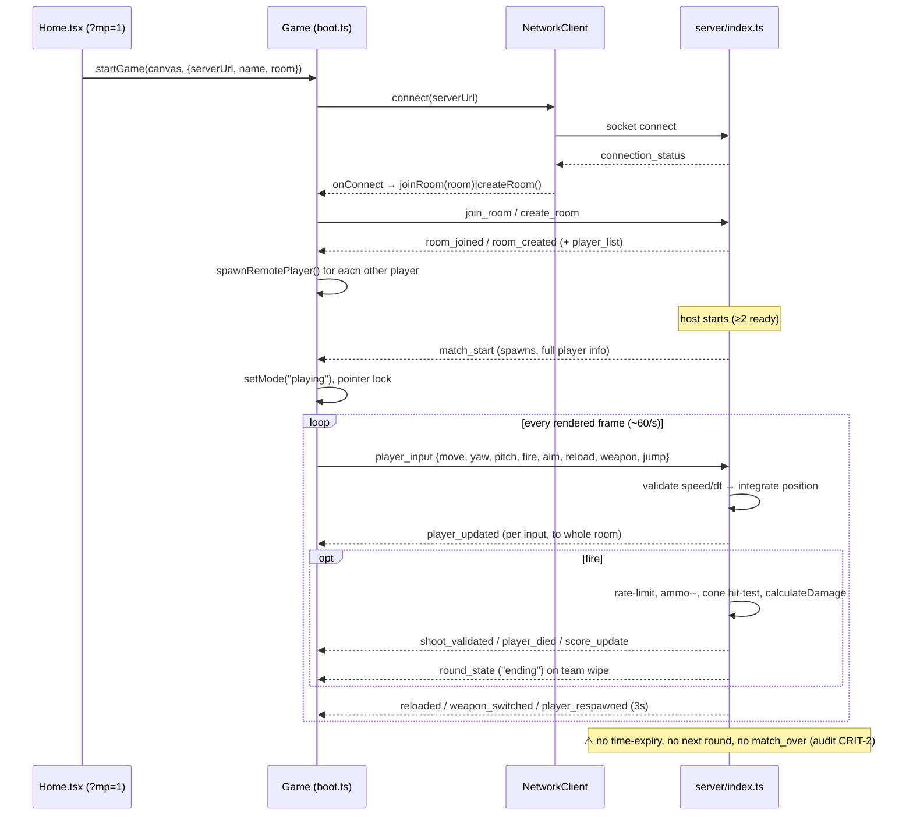
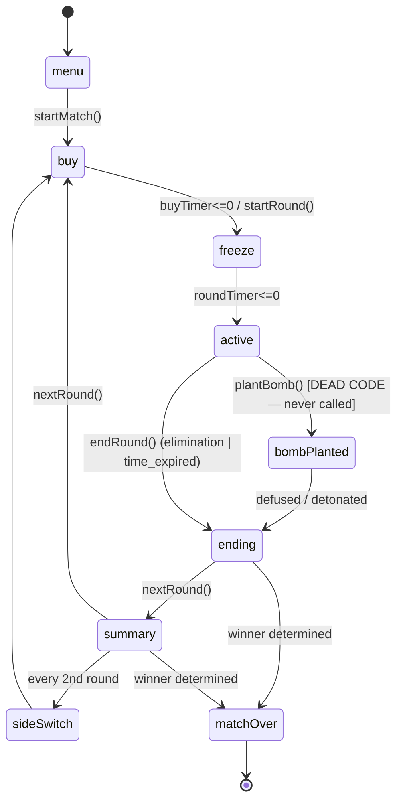

# 04 — System Architecture

## 1. Architectural Style (current)

**Client-heavy multiplayer game in two topologies:**

1. **Solo mode (default):** single-tier client application. Browser runs rendering,
   simulation, AI, and rules locally. No server involved.
2. **Multiplayer mode (`?mp=1`):** client/server. Browser is a *dumb terminal for state* +
   *smart predictor for feel* (local physics), while `server/index.ts` (Socket.IO, in-memory)
   is authoritative over movement validity, combat resolution, economy, and respawn.

Both topologies share one codebase and one protocol file. There is **no database, no external
service, no message broker** — and none is currently needed (see 06).

## 2. Context Diagram (C1)

- Solo mode: `GC` alone (NC idle, GS not contacted).
- Multiplayer: `GC` still simulates locally (movement/physics/rendering) but delegates
  combat truth, purchases, respawn, and round state to `GS`.

## 3. Component Diagram (C2)

Note the server importing **client-tree** modules (`src/game/systems/damage.ts`,
`src/game/config.ts`): `src/` is a *shared library*, not purely client code. This is
intentional (single source of truth for rules) but blurs the directory meaning — documented
in 10_DEVELOPER_GUIDE.md.

## 4. Runtime Data Flow

### 4.1 Solo frame (every 1/60 s)

### 4.2 Multiplayer session (room → match)

## 5. State Machines

### 5.1 Client game modes (`boot.ts:Mode` — *de facto* state machine)
`title → playing ⇄ paused → (victory | gameover)`; `playing → buy → playing` per round;
transitions enforced by `setMode()` toggling DOM screens (`title/buy/pause/end`).

### 5.2 Round FSM (`systems/round.ts` — shared concept, client-side authoritative in solo)

### 5.3 Server room FSM (`server/index.ts`)
`waiting → (startMatch) → in_progress` … and nothing further (no `finished` transition is
ever executed — audit CRIT-2).

### 5.4 Bot FSM (`ai/bot.ts`)
18 states: `idle, guard, patrol, moveToObjective, seekCover, investigate, search,
acquireTarget, aiming, engaging, reloading, retreating, flanking, supportTeammate, planting,
defusing, rotate, dead` — driven by perception timers, difficulty tables, and LOS raycasts.

## 6. External Integrations
**None.** No HTTP API, no database, no third-party services, no analytics, no CDN assets
(everything is same-origin; `vite.config.ts base: "./"`). The only I/O beyond sockets:
`localStorage` and GLB/WASM fetches from `public/`.

## 7. Infrastructure Requirements (current truth)
- One static file host (or any SPA server) for the client build.
- One Node.js process (`server/index.ts`) when MP is used. Node ≥ 20.19 recommended
  (Vite 7 requirement — observed warning on 20.16).
- Nothing else.
