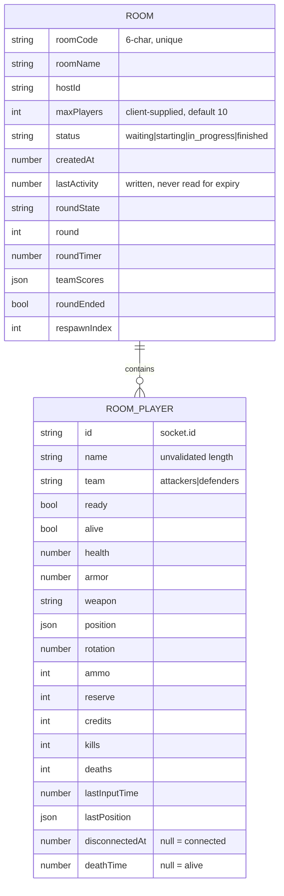

# 06 — Data & Persistence Architecture

## 1. Current Reality: No Database

There is **no database, no ORM, no migration system, no server-side persistence** of any kind
(verified: `server/index.ts` uses only in-memory Maps; no other storage library in
`package.json` dependencies).

All state is either:

1. **Ephemeral process memory** — server rooms/matches (`server/index.ts`).
2. **Ephemeral client memory** — the `Game` instance and subsystems.
3. **Browser-local key-value** — `localStorage` under prefix `game.` (`src/game/storage.ts`).
4. **Static assets** — `public/` (weapon GLBs, Rapier WASM), bundled JS/CSS.

### Current data model (in-memory shapes)

### Client localStorage keys

| Key | Type | Written by | Meaning |
|---|---|---|---|
| `game.highScore` | number | `boot.ts:endMatch()` via `highScore.set` | best kill count, device-local only |
| `game.<audio mute flag>` | boolean | `audio.ts` | mute preference |

(Both accesses are wrapped in try/catch — blocked storage degrades silently.)

## 2. Lifecycle & Integrity Rules (as implemented)

- **Room creation:** on `create_room`; code collision retried; cap `MAX_ROOMS = 100`.
- **Join rules:** only while `status === "waiting"`; rejected when full or in-progress.
- **Host transfer:** on host disconnect/leave while waiting → first remaining connected player.
- **Room deletion:** `leave_room` empties it (and not in-progress) → immediate delete;
  disconnect → all players `disconnectedAt` → deleted 10 s later by the deferred check.
  ⚠ Neither path calls `broadcastRoomList()` after the auto-delete (02 LOW-3).
- **Match state:** seeded by `startMatch()` (resets players, round 1, buy phase). No
  transitions out of `in_progress` exist (CRIT-2).
- **Transactions:** none needed — single-threaded Node event loop is the transaction
  boundary; correctness relies on synchronous handler bodies (true today).

## 3. Why No Database Is Justified — For Now

Every stored fact (room rosters, kill counts, credits) is meaningless outside a live match
and expires with the session. Persistence requirements explicitly deferred in product scope:
accounts, cross-device leaderboards (README), match history. Adding a DB before those
requirements exist would violate the "no unnecessary complexity" rule.

## 4. When Persistence Becomes Necessary — Target Options (proposals, not current design)

| Requirement (trigger) | Recommended store | Rationale |
|---|---|---|
| Cross-device high scores / simple profiles | **SQLite (file) or Postgres** behind a tiny REST layer on the same Node process | one deployable, no new infra; matches "no microservices" rule |
| Player accounts + auth | Postgres + session/JWT; server gains an auth module | only when multiplayer becomes public |
| Match history / telemetry / anti-cheat analytics | Postgres (normalized) + batched writes from the tick loop | never write per-tick synchronously |
| Room recovery across server restarts | not recommended — in-memory rooms are disposable by design | a crashed match is a dead match |

**Schema direction (only when accounts land):** `players(id, name unique, created_at)`,
`sessions(...)`, `matches(id, mode, started_at, ended_at, winner_team)`,
`match_players(match_id, player_id, team, kills, deaths, credits_spent)`,
`high_scores(player_id, score, set_at)` with FKs + indexes on `(player_id)`, `(started_at)`.

**Do NOT introduce:** MongoDB/Redis/message queues/cloud services for the current feature
set — nothing in the audited requirements needs them.

## 5. Data Risks Today

| Risk | Evidence | Mitigation |
|---|---|---|
| Total state loss on server restart | in-memory Maps | accepted (matches are ephemeral); document restart behavior |
| Unbounded `maxPlayers` from clients | `server/index.ts:288` (`data.maxPlayers ?? 10`, no clamp) | clamp server-side (roadmap R-MP-3) |
| Unvalidated strings stored & broadcast | `roomName`, `playerName` | length/charset validation (roadmap R-SEC-1) |
| `lastActivity` never used | written, never read | either use for room expiry or remove |
