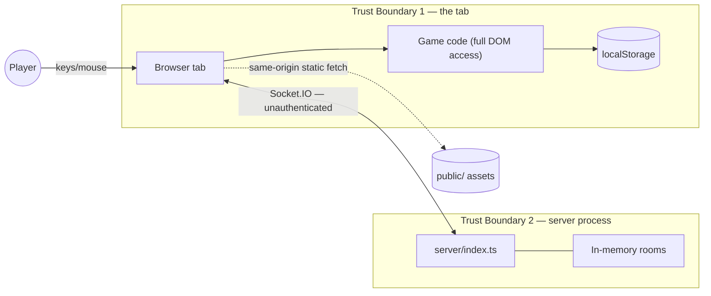

# 08 — Security Architecture

Honest threat model for the system **as it is**, sized for its current deployment posture
(local/LAN dev + small group play). Several items below are acceptable *today* and become
mandatory before any public deployment — they are marked accordingly.

## 1. Assets & Trust Boundaries

- **No authentication exists.** Identity = `socket.id`. Anyone who can reach the port is a player.
- **No authorization levels** beyond `hostId` checks for `start_match` and room ownership.
- **No secrets** anywhere in the repo (verified — nothing to leak, which is also why there is
  no `.env` handling; `PORT`/`CLIENT_ORIGIN` are read from the environment directly).

## 2. Attack Surface Inventory

| # | Surface | Current control | Risk today | Required before public |
|---|---|---|---|---|
| A1 | Socket messages (any JSON) | switch + per-handler checks | garbage tolerated (unknown → error) | runtime schema validation (R-SEC-1) |
| A2 | `create_room` spam | `MAX_ROOMS = 100` | bounded DoS of room table | per-IP/conn rate limit (R-SEC-2) |
| A3 | `player_input` flood | movement speed + delta clamps; weapon interval | CPU/bandwidth amplification: every input → full-room broadcast | per-socket input rate cap + interest management (R-MP-4) |
| A4 | `playerName` / `roomName` | none | stored & broadcast raw. **No current XSS** (names never enter `innerHTML`; killfeed uses fixed strings — verified). Becomes an injection vector the moment a lobby UI renders names as HTML | sanitize/length-cap at the boundary (R-SEC-1) |
| A5 | `maxPlayers` field | default 10, otherwise client-controlled | resource abuse within room cap | clamp server-side (R-SEC-1) |
| A6 | Cheat: speed/teleport | server clamps (`SERVER_MOVE_SPEED`, `MAX_POSITION_DELTA`) | decent; dt from server clock | keep; add server-side collision (MED-1) |
| A7 | Cheat: fire-rate/ammo | server-enforced interval + ammo ownership | solid for current scope | keep |
| A8 | Cheat: aim/wallhack | client raycasts visuals; server hit-test ignores walls (dot-cone only) | **server-side noclip + wall-shots possible** (no map geometry on server) | share `MAP_BLOCKS` AABBs server-side for LOS/hit blocking |
| A9 | CORS | `origin: "*"` default | fine for LAN; allows any site to drive a local server via browser | restrict to deploy origin(s) |
| A10 | Static assets | same-origin only; `verify-game.mjs` server has path traversal guard (its own); production static host is external | standard SPA hygiene | standard headers (CSP, X-Content-Type-Options) at host |
| A11 | WASM/GLB loading | same-origin `/rapier_wasm3d_bg.wasm`, `assets/weapons/*` | poisoning requires host compromise | integrity via hosting controls |
| A12 | localStorage (`game.*`) | non-sensitive (high score, mute) | trivially editable → fake high score | acceptable; never store credentials there |
| A13 | Bot/AI determinism | seeded RNG | none | none |

## 3. Data Protection

- Collected personal data: **none** (no accounts, no PII; a player-chosen display name is the
  only user data and it stays in RAM).
- localStorage holds no sensitive data.
- No cookies, no trackers, no third-party calls (verified: no external URLs in `src/`/`server/`).

## 4. Server Authority Posture (summary — details in 02/07)

| Domain | Server-authoritative? | Notes |
|---|---|---|
| Movement validity | ✅ clamped | but no wall collision server-side (A8) |
| Firing rate / ammo | ✅ | |
| Hit detection | ✅ (cone) | ignores walls (A8); damage application bug CRIT-3 |
| Health/credits/purchases | ✅ | CRIT-3 corrupts health truth |
| Round progression | ⚠ partial | timers run; expiry/next-round/match-end missing (CRIT-2) |
| Visual/game feel | ❌ client | correct — latency makes client-authoritative feel mandatory |

## 5. Abusive-Input Edge Cases Found During Audit

- `player_input` with NaN fields: `Math.hypot(NaN)` → NaN comparisons false → position
  corrupted (becomes NaN and propagates via broadcast). No numeric sanity checks exist.
  → add `Number.isFinite` validation (R-SEC-1).
- `player_input` with `switchWeapon: "nonexistent"`: safely ignored (tested — `multiplayer2.test.ts:185`).
- `purchase` outside buy phase: correctly rejected (round-state gate).

## 6. Secure Deployment Checklist (when going public)

1. Restrict CORS to the deployed origins (`CLIENT_ORIGIN` env already exists — use it).
2. Add message validation layer (single `validate(msg)` choke point before handlers).
3. Add per-connection rate limits (rooms/min, inputs/s, bytes/frame).
4. Clamp `maxPlayers` (≤ 10) and string lengths (name ≤ 24, room ≤ 32).
5. Numeric guards on all client-supplied numbers (`Number.isFinite`, range checks).
6. Serve client + server behind TLS; same-origin deploy (Vite static + reverse-proxy
   `/socket.io` to the game server) to kill cross-origin issues entirely.
7. Process hygiene: run under a supervisor (pm2/systemd), `PORT` via env, structured logs,
   graceful shutdown (close `io`, flush nothing — state is disposable by design, see 06).
8. Add CSP for the static host; keep inline script usage (none today) out.
