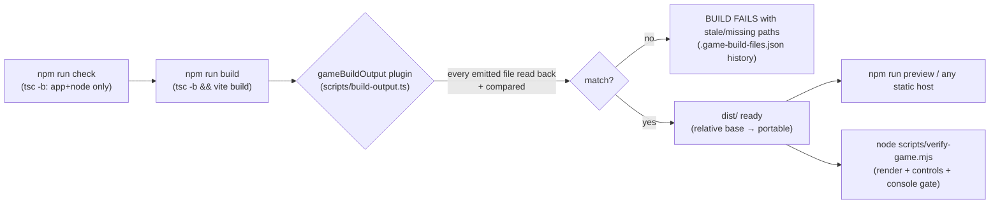
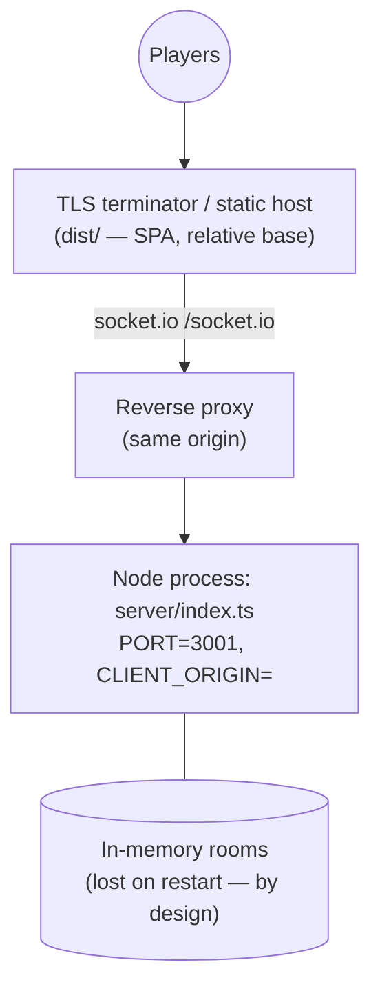

# 09 — Deployment Architecture

## 1. Environments

| Environment | Client | Game server | Data | Verified? |
|---|---|---|---|---|
| **Dev** | `npm run dev` → Vite on **:3000** (HMR) | `npm run dev:server` → tsx `server/index.ts` on **:3001** (or both via `npm run dev:all`) | none | ✅ exercised during audit |
| **Test** | vitest (node) boots `server/index.ts` itself on **:31337/:31338** | Playwright e2e boots server on **:31339** + `vite preview :3000` | none | ✅ config read; e2e not executed in audit |
| **Smoke/self-check** | `npm run build` then `node scripts/verify-game.mjs` (static server on a random port, SwiftShader-capable) | **not started** — static only | none | ✅ script read |
| **Production** | static SPA from `dist/` (`base:'./'` → any static host) | `server/index.ts` must be run **separately** (tsx or a build); no process manager, no Docker in repo | in-memory only | ⚠ nothing beyond `vite preview` exists |

## 2. Build Pipeline



Facts to respect (from `info.md` + `scripts/build-output.ts`):
- Do **not** delete `dist/` or rebuild repeatedly to "fix" a stale-output failure — read the
  error; the plugin preserves output and names offenders.
- Run builds sequentially; the plugin verifies files visible at build completion (not an
  atomic publish).
- The >500 kB chunk warning for a Three.js bundle is expected, not a failure.
- `npm run check` type-checks **client code only** (`tsconfig.json` references
  `tsconfig.app.json` [include: src] + `tsconfig.node.json`). `server/index.ts` is not in
  either include-set, and `tsconfig.server.json` is not referenced by the solution file —
  the server is only type-checked implicitly when tsx/vitest imports it. (Audit MED-5.)

## 3. Runtime Topology (production, target minimal)



- **Same-origin deployment recommended:** host `dist/` and reverse-proxy `/socket.io` to the
  game server → no CORS at all in production (`CLIENT_ORIGIN` becomes unnecessary).
- **Client/server decoupling is already real:** `vite.config.ts base:'./'` makes `dist/`
  relocatable; the client discovers the server purely from `?server=` param / hardcoded
  default (`Home.tsx`) — for production, the server URL must become same-origin-relative or
  env-injected (roadmap R-MP-5).
- **No health endpoint exists.** `GET /socket.io/?EIO=4&transport=polling` returning the
  handshake JSON is the de-facto liveness check (used during the audit).

## 4. Configuration & Environment

| Variable | Consumer | Default | Notes |
|---|---|---|---|
| `PORT` | `server/index.ts` | `3001` | also settable by vitest/playwright to isolated ports |
| `CLIENT_ORIGIN` | `server/index.ts` CORS | `*` | restrict in prod (08 §6) |
| Client server URL | `Home.tsx` `?server=` param | `http://localhost:31337` | ⚠ mismatches server default (HIGH-4) |
| Node version | Vite 7 requirement | ≥ 20.19 (or 22.12+) | audit env had 20.16 → warning observed |

No `.env` files exist; nothing reads dotenv. Keep it that way until a second config knob
appears, then adopt one convention.

## 5. Observability & Operations

- **Logging:** bare `console.log` on server (connect/disconnect); none structured.
  Client logs via `console.log("[NET] …")` (dev-oriented; also emitted in production builds).
- **Metrics:** none server-side. Client-side renderer stats exist (`renderer.info`, fps) but
  are only exposed as debug hooks (`__gameDebug`), never shipped to any sink.
- **Error tracking:** none.
- **Backups:** N/A (no persistent data — see 06).
- **Recovery model:** server restart = all rooms/matches lost (accepted; document it).
  Client refresh = full remount (StrictMode double-mount must stay safe — CRIT-1 invariant).

## 6. CI/CD

**None exists** (no pipeline files, no workflows — verified). Recommended minimal pipeline
when the project gets a Git host (roadmap R-OPS-1):

```yaml
# target shape (illustrative)
install → npm run check → npm run test (vitest)
        → npm run build → node scripts/verify-game.mjs (headless chromium)
        → (optional) npx playwright test tests/multiplayer.e2e.ts
```

## 7. Known Deployment Gaps (consolidated)

| Gap | Ref |
|---|---|
| No production launcher for the game server (no build of `server/index.ts`; tsx-only) | R-OPS-2 |
| No Docker/systemd unit/pm2 config | R-OPS-2 |
| No health/ready endpoint | R-OPS-3 |
| Client hardcodes a dev-port server default | HIGH-4 / R-MP-5 |
| e2e depends on `vite preview` (requires prior build) and free ports 3000/31339 | note |
| SwiftShader in CI ⇒ render checks prove correctness, never GPU performance | `verify-game.mjs` header |
