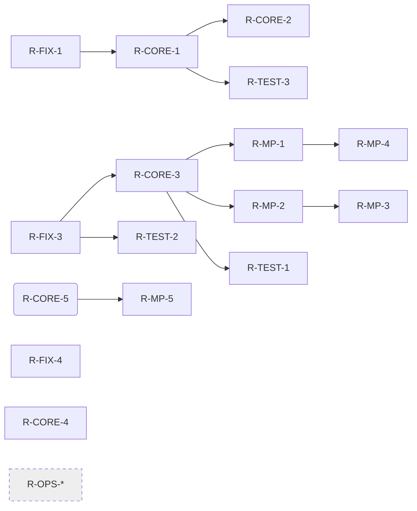

# 11 — Implementation Roadmap

From the audited baseline (Phase 0) to the target architecture. Priorities: **P0 = blocks
correct development/play today**, P1 = structural debt that compounds, P2 = quality/scale,
P3 = optional polish. "Mandatory" vs "optional" is explicit per phase.

Legend: ⛔ blocks a feature · 🧹 debt · ✨ enhancement. IDs are referenced by other docs
(R-XXX-n).

---

## Phase 0 — Baseline (exists, keep)

| Task | Status |
|---|---|
| Solo game playable end-to-end (movement/bots/weapons/economy/rounds/UI/audio) | ✅ verified |
| MP server core (rooms/combat/purchases/respawn) + protocol tests | ✅ verified |
| Build pipeline + output verification + smoke self-check | ✅ verified |
| Pure rules layer (damage/round/economy/weapons/team) + unit tests | ✅ verified |
| This documentation set | ✅ created |

---

## Phase 1 — Critical corrections (MANDATORY)

| ID | Task | Priority | Depends on | Files | Outcome / acceptance criteria | Testing |
|---|---|---|---|---|---|---|
| **R-FIX-1** | ⛔ Fix physics singleton race (StrictMode double-mount): single wasm init promise that survives dispose, generation token guarding world assignment; never two concurrent `RAPIER.init()` | P0 | — | `src/game/systems/collision.ts` | Dev runs are deterministic: no wasm `unreachable`/aliasing errors; camera/movement correct after remount; capsule always created for the live session | `npm run dev` + two manual remounts; extend `verify-game.mjs` already covers direction assertions; add a vitest simulating dispose-then-init |
| **R-FIX-2** | ⛔ Fix server damage application (heal-on-hit): use `result.damage` against current health, keep `calculateDamage` contract documented | P0 | — | `server/index.ts`, `damage.ts` header comment | victim health strictly decreases by dealt damage; kills occur at intended rates | extend `multiplayer2.test.ts`: two-shot kill at 110+34 dmg model |
| **R-FIX-3** | ⛔ Complete the MP match loop server-side: active-round time expiry → round end; next round progression; `match_over` emission; room back to `finished`/re-startable | P0 | — | `server/index.ts` | full match can end; clients receive `round_state`/`match_over`; room GC works after finish | new vitest integration case: force timers with tiny TICK config, assert sequence |
| **R-FIX-4** | ⛔ Unify MP server URL: default client target to the dev server port (3001) or same-origin in prod; document override | P0 | — | `src/pages/Home.tsx` | `?mp=1` works out-of-the-box with `dev:all`; e2e unaffected (explicit ports) | manual + playwright e2e still green |

## Phase 2 — Core architecture improvements (mostly mandatory)

| ID | Task | Priority | Depends on | Files | Outcome | Testing |
|---|---|---|---|---|---|---|
| **R-CORE-1** | 🧹 Split `boot.ts` God-class: thin `Game` orchestrator + `HudController` (DOM ids in one map) + `SoloMatchController` + `MpMatchController` + `WeaponViewController`; add `RoundManager` setters to kill `["round"]` private access | P1 | R-FIX-1 | `src/game/boot.ts` (+ new modules) | no behavior change; each new unit ≤ ~300 lines; DOM ids single-sourced | `npm run check`, `npm run test`, `npm run build` + verify smoke; manual solo+MP run |
| **R-CORE-2** | 🧹 Remove/retire legacy `enemies.ts` from the live path (delete after migrating any used behavior); drop unused `state.ts` `GameStateMachine` or wire it as the mode FSM | P1 | R-CORE-1 | `enemies.ts`, `boot.ts`, `state.ts` | smaller shot-target list, one enemy concept | verify smoke + solo round |
| **R-CORE-3** | 🧹 Extract server into modules: `transport.ts` (io/dispatch), `rooms.ts`, `match.ts` (tick + FSM incl. R-FIX-3), `validation.ts`; share `config.ts` spawn tables instead of duplicating | P1 | R-FIX-3 | `server/**` | no `as any` on handler signatures; spawn tables single-sourced | vitest suites unchanged & green |
| **R-CORE-4** | 🧹 Fix type-check coverage: reference `tsconfig.server.json` from solution or fold server into node project; remove unused deps (phaser, lucide-react) | P1 | — | `tsconfig*.json`, `package.json` | `npm run check` catches server type errors | `npm run check` fails on deliberately-broken server file (manual proof) |
| **R-CORE-5** | 🧹 Validate protocol at the boundary: runtime guard (`validate(msg)`) before dispatch; clamp `maxPlayers`, name lengths, numeric `Number.isFinite` checks | P1 | — | `server/**`, `shared/types.ts` | malformed/NaN input cannot corrupt state (08 §5) | negative vitest cases |

## Phase 3 — Integration & consistency (mix mandatory/optional)

| ID | Task | Priority | Depends on | Files | Outcome | Testing |
|---|---|---|---|---|---|---|
| **R-MP-1** | 🧹 Server-side map collision + LOS for bullets & movement using shared `MAP_BLOCKS` (kills server-side noclip/wall-shots) | P1 | R-CORE-3 | `server/**`, `config.ts` | server raycasts block on walls; movement clamped to map | vitest: shoot through a wall → miss |
| **R-MP-2** | ✨ Add ack-based ready state (replace 200 ms timing waits) and reconnect-to-player path (id → stable playerId token) | P2 | R-CORE-3 | `server/**`, `client.ts`, `types.ts` | tests no longer sleep; reconnect keeps identity | vitest reconnect case |
| **R-MP-3** | ✨ Interest management: replace per-input full-room broadcast with throttled snapshot (10 Hz) + event-driven deltas; send `player_input` at 20-30 Hz, not 60 | P2 | R-MP-2 | `boot.ts` MP input loop, `server/**` | bandwidth O(players), not O(players²)·60Hz | measure message counts in a vitest run |
| **R-MP-4** | 🧹 Client-side server reconciliation: apply authoritative corrections (position clamp/teleport threshold), so MED-1 drift disappears | P2 | R-MP-1 | `boot.ts` MP update | correction applied without visible jitter at 60 Hz RTT<100ms | manual + e2e |
| **R-MP-5** | ✨ Minimal lobby screen (room code entry / create) replacing URL-param-only MP entry; render names as text (never HTML) | P2 | R-SEC-1 | `Home.tsx`, `boot.ts` | join/create room from UI | e2e lobby flow |
| **R-GAME-1** | ✨ Wire bomb plant/defuse (logic already exists + tested) or delete the states from the client FSM; same decision for `chat` message | P2 | — | `round.ts` wiring or trim, `boot.ts`, `server/**` | either feature exists or dead code is gone | unit tests updated accordingly |
| **R-GAME-2** | ✨ Decide `EnemyManager` fate in product terms (bots already cover gameplay) — tied to R-CORE-2 | P2 | R-CORE-2 | — | one enemy system | — |

## Phase 4 — Testing & validation (MANDATORY before release)

| ID | Task | Priority | Depends on | Outcome | Testing |
|---|---|---|---|---|---|
| **R-TEST-1** | Server tick/FSM unit tests (round timers, respawn once-per-death, room GC) — currently only integration | P1 | R-CORE-3 | fast deterministic failure isolation | vitest |
| **R-TEST-2** | Full-match e2e: host+2 players via Playwright → complete 2 rounds → `match_over` on screen | P1 | R-FIX-3, R-MP-5 | end-to-end proof of MP lifecycle | `tests/` e2e |
| **R-TEST-3** | Extend `verify-game.mjs`: assert `__gameProbe` non-zero origin at spawn (catches CRIT-1-class regressions mechanically) | P1 | R-FIX-1 | dev-time breakage caught in CI, not by players | script |
| **R-TEST-4** | CI pipeline: check → test → build → verify (+ e2e) | P2 | Git hosting | green/red on every push | CI |

## Phase 5 — Production readiness (optional until deployment is real)

| ID | Task | Priority | Outcome |
|---|---|---|---|
| **R-OPS-1** | Same-origin prod deploy: static host + reverse-proxy `/socket.io`; CORS locked; TLS | P2 | no cross-origin config, 08 checklist §6 done |
| **R-OPS-2** | Server production run story: build/serve `server/index.ts` (tsx watch → node dist or tsx in process manager), Dockerfile or systemd unit, graceful shutdown | P2 | one-command prod start |
| **R-OPS-3** | `/healthz` endpoint + structured logs (connect/disconnect/room counts) | P2 | monitorable |
| **R-OPS-4** | Client error sink (window.onerror → server or console aggregation) + production log-level for `[NET]` logs | P3 | diagnosable in the wild |
| **R-POL-1** | Asset polish: add missing `pistol/model.glb`; clean `특수 요원` killfeed artifact; correct HUD initial markup | P3 | no fallback warnings; coherent UI copy |
| **R-POL-2** | Feature completion by roadmap-worthiness: crouch, SMG/shotgun/knife purchases, grenades — each behind a small spec, only after R-CORE-1 | P3 | per spec |

---

## Dependency Graph (simplified)

## Mandatory vs Optional Summary

- **Mandatory (blocking):** R-FIX-1…4, R-CORE-1, R-CORE-3, R-CORE-4, R-CORE-5, R-TEST-1…3.
- **Strongly recommended before any public MP:** R-MP-1…5, R-TEST-4, R-OPS-1…3.
- **Optional/polish:** R-GAME-1/2, R-POL-1/2, R-OPS-4.

No full rewrite is recommended: the pure systems layer, protocol tests, build verification,
and solo gameplay are sound and are the foundation the target architecture reuses.
